<div align="center">


# ⚡ ZYROX ENCRYPTION




[](https://termux.dev)
[](https://python.org)
[](https://adoptium.net)
[]()
[](LICENSE)
[]()

**APK me encryption lagao — apne phone se, sirf ek command me.**

`strings encrypt` · `debug strip` · `hidden keys` · `v1+v2+v3 sign` · `zero plaintext leak`

</div>

---

## 🚀 Install (Termux — 60 second)

```bash
pkg update -y && pkg install -y python openjdk-17 curl tar unzip git
termux-setup-storage          # popup me "Allow" dabayein

git clone https://github.com/zyroxteam/zyrox-encryption
cd zyrox-encryption
bash setup.sh                 # Java check + apktool + apksigner (khud download)
bash install.sh               # 'zyrox' command install
```

Bas. Ab kahin se bhi chalao. 👇

**Pehle ek baar check kar lein ki sab theek laga hai:**
```bash
zyrox --self-test
```
```
[1/3] toolchain check…
    ✅ java      : /data/data/com.termux/files/usr/bin/java  (v17)
    ✅ apktool   : apktool.jar  2.9.3
    ✅ signer    : apksigner (system) 0.9
[2/3] crypto round-trip (encrypt → decrypt == original)…
    ✅ 33/33 PASS  (ASCII, हिन्दी, 中文, العربية, emoji, NUL, 500-char)
[3/3] zip writer + alignment…
    ✅ zip ok · arsc aligned · .so page-aligned
   ✅ SELF-TEST PASS — tool ready hai!
```

---

## 💻 Usage

```bash
zyrox /sdcard/myapp.apk
```
```
[1/6] apktool se decode (smali + resources)…
[2/6] strings encrypt + debug strip…   ✅ 12,404 strings encrypt
[5/6] sign (v1+v2+v3)…
[6/6] verify (proof)…                  Verified using v1/v2/v3: true
✅ HO GAYA → /sdcard/Download/zyrox/myapp-protected.apk
```

### Path aise dete hain

```bash
zyrox /sdcard/Download/myapp.apk                    # Downloads se
zyrox /sdcard/myapp.apk                             # sdcard root se
zyrox /storage/emulated/0/Android/data/mygame.apk   # kisi bhi path se
zyrox ~/storage/downloads/myapp.apk                 # Termux storage shortcut
zyrox "/sdcard/Protect Apk/myapp.apk"               # SPACE wale path me QUOTES zaroori!
zyrox /sdcard/Protect\ Apk/                        # ya poora folder do — .apk khud dhoondh lega
```

> ⚠️ **Path me SPACE hai?** Quotes lagana mat bhoolo — bina quotes ke shell path ko tod
> deta hai aur `unrecognized arguments: Apk/` error aata hai.

> `zyrox` command na mile to: `cd zyrox-encryption && bash install.sh` dobara chalayein.
> Output `out/` me banta hai **aur** `/sdcard/Download/zyrox/` me copy ho jata hai (file manager se install karo).

### Poori options list

| Option | Kya karta hai |
|---|---|
| `zyrox /sdcard/app.apk` | **default** — strings encrypt + debug strip + sign + storage copy |
| `zyrox /sdcard/app.apk --keys my.jks` | apni keystore se sign (shortcut) |
| `zyrox /sdcard/app.apk --ks-file r.jks --ks-pass PASS --alias mykey` | apni release keystore se sign (poora form) |
| `zyrox /sdcard/app.apk --info` | sirf jaankari (kuch modify nahi) |
| `zyrox /sdcard/app.apk --no-strings` | sirf debug-strip + re-sign |
| `zyrox /sdcard/app.apk --keep-debug` | line numbers rakho (testing ke liye) |
| `zyrox /sdcard/app.apk --simple-keys` | keys direct (debug karna aasan) |
| `zyrox /sdcard/app.apk --anti-debug` | debugger attach ho to app turant band |
| `zyrox /sdcard/app.apk --anti-root` | rooted device pe app turant band (su + test-keys) |
| `zyrox /sdcard/app.apk --harden-manifest` | `android:debuggable=true` mile to `false` |
| `zyrox /sdcard/app.apk --min-len 8` | 8 se chhoti strings encrypt nahi (dex chhota, fast) |
| `zyrox /sdcard/app.apk --no-sign` | unsigned output |
| `zyrox /sdcard/app.apk --out /sdcard/myout` | apna output folder |
| `zyrox /sdcard/app.apk --to-storage` | phone storage me copy (default ON) |
| `zyrox --self-test` | **install check** — java/apktool/signer + crypto + zip verify (APK ki zaroorat nahi) |
| `zyrox --version` · `zyrox --help` | version / help |

**🔥 Best protection (sab kuch ON):**
```bash
zyrox "/sdcard/Protect Apk/myapp.apk" --anti-debug --anti-root --harden-manifest --min-len 4
```

**Proof report:**
```bash
python zyrox-verify.py /sdcard/myapp.apk out/myapp-protected.apk
```

---

## 🛡️ Ye karta kya hai (6 steps)

| Step | Kaam |
|---|---|
| **1. Decode** | `apktool` se APK kholta hai (smali + resources) |
| **2. Encrypt** | Har `const-string` encrypt → runtime pe decryptor call. Decompiler me sirf `\u3b00\u7771…` blob dikhta hai |
| **3. Hide keys** | Random package/class/method naam. **Har string ki APNI key** (random seed) — sirf ek global mask smali me **XOR-split** (direct constants nahi). Same text do jagah ho to bhi ciphertext alag! |
| **3b. Guards** *(optional)* | `--anti-debug` / `--anti-root`: `Application.onCreate` me guard inject — debugger ya root mile to app turant band (try/catch me, legit user kabhi crash nahi) |
| **4. Strip debug** | `.line` `.local` `.param` `.prologue` hatata hai → decompile karke padhna mushkil |
| **5. Repack + align** | **Sirf dex replace** karta hai (resources/assets/manifest original), `resources.arsc` 4-byte + `.so` 4096-byte aligned |
| **6. Sign + verify** | Google ke apksigner se **v1 + v2 + v3** sign, phir verify — install har Android pe |

### Runtime decryptor (asli magic)

Har build pe naya random decryptor banta hai — pure smali, koi library nahi:

```smali
const v5, 0x46c3          # mask ka aadha hissa
xor-int/lit16 v5, v5, 0x3e1a     # mask = 0x46c3 ^ 0x3e1a  (build ke hisaab se badalta hai)
...
invoke-virtual {p0, v2}, Ljava/lang/String;->charAt(I)C
xor-int/2addr v3, v5      # seed = charAt(0) ^ mask  (har string ki apni seed!)
mul-int/lit16 v6, v5, 0x0025
add-int/lit16 v6, v6, 0x001b    # mult = seed * 0x25 + 0x1b
...
xor-int/2addr v3, v4      # char-level decrypt
```

v1.2 me **per-string keys**: ek hi plaintext do jagah ho to bhi dono ka ciphertext alag hota hai —
pattern analysis se kuch nahi milega.

Java ke `char` semantics ke saath **byte-for-byte identical** — `x = (seed + i * mult) & 0xFFFF` (int overflow round-trip verified), UTF-16 code units pe kaam karta hai, isliye **Hindi/Chinese/Arabic text aur emoji (surrogate pairs)** bhi 100% safe hain.

---

## ✅ Verified (yahi repo ke code se test kiya gaya)

| Test | Result |
|---|---|
| Real APK full pipeline | ✅ **80/80 strings** encrypt + decrypt exact match |
| Multi-dex (`classes.dex` + `classes2.dex`) | ✅ **82/82 strings**, dono dex handled |
| Native libs `.so` | ✅ 4096-byte page aligned |
| `resources.arsc` | ✅ 4-byte aligned |
| Signing | ✅ **v1 + v2 + v3 = true** (Google apksigner verify) |
| Hidden keys mode | ✅ XOR-split detected & round-tripped |
| Custom keystore (`--keys`) | ✅ cert DN match confirm |
| Edge cases | ✅ quotes, backslash, `\n`/`\t`, **Hindi/Chinese/Arabic**, **emoji**, NUL, 400-char strings |
| Self-test | ✅ 33 crypto cases + 12 per-string cases + zip/alignment (`zyrox --self-test`) |
| Unit tests | ✅ **23/23 pass** (`python tests/test_zyrox.py`) — CI me bhi chalte hain |
| Per-string keys | ✅ same plaintext → alag ciphertext, decrypt 100% match |
| Guard injection | ✅ existing Application + naya Application dono cases me inject |

> ⚠️ **Honest note:** asli phone pe install karke runtime test mera nahi hua (sandbox me Android device nahi tha).
> Encryption + signing + zip structure **100% verified** hai — app ka behaviour aapko test karna hoga (checklist neeche).

---

## 🔑 Signing — 2 raaste (yaad rakhein)

| Option | Kab | Result |
|---|---|---|
| **Default (nayi key)** | naya app / testing | `keys/<app>.jks` banti hai + password `keys/<app>-password.txt`. Protected APK **nayi app** ki tarah install hogi |
| **`--keys my-release.jks`** | **purani app ka update** | Same signature → users ko normal update milta hai ✅ |

⚠️ Keystore + password sambhal ke rakhein — Play Store ki key kho dena = app ka control kho dena.
⚠️ Play Store pe **AAB** upload hota hai; ye tool **single .apk** pe chalta hai. Production me pehle Android Studio me **R8/ProGuard** (minify + shrink) lagayein, phir ye tool.

---

## 📱 Troubleshooting (Termux)

| Problem | Fix |
|---|---|
| `Java nahi mila` | `pkg install -y openjdk-17` (ya `openjdk-21`) |
| `zyrox: command not found` | `cd zyrox-encryption && bash install.sh`, ya `export PATH="$PREFIX/bin:$PATH"` |
| APK file nahi mili | `termux-setup-storage` chalayein, phir `ls ~/storage/downloads` |
| Bada APK slow / memory | Normal hai — screen on rakhein, `termux-wake-lock` laga rehne dein, 2-3 GB free space |
| apktool decode fail | APK protected/split (`.apks`/XAPK) hogi — single APK chalegi. Latest apktool: `iBotPeaches/Apktool` se `apktool_2.11.x.jar` download karke `tool/apktool.jar` replace karein |
| App crash ho rahi | `--keep-debug` se dobara banao (line numbers wapas), phir `--no-strings` try karein — isse pata chalega crash kis layer se hai |
| Verify FAIL | `--no-sign` se output lein aur PC/`apksigner` se sign karein |

---

## 🧪 Publish se pehle (MUST)

1. **Backup** original APK (PC / dusra folder)
2. `adb install -r` ya file manager se install; purani version ho to pehle uninstall
3. Ye sab check karein: splash → login/OTP → home → **database** → camera/files/location → **push notification** → ads → payment
4. `adb logcat | grep -iE "fatal|exception"`
5. Kam se kam 2 phones pe test (Android 8-10 + Android 13-15)

**Zyada risk wali apps:** jinke andar apna **anti-tamper / dex hash check** ho, jinka **native (C++) code** dex strings padhta ho, ya jo `attachBaseContext` me hi verify karti hon.

---

## ⚠️ Legal + limits

- **Sirf apni APK pe chalayein.** Kisi aur ki app repack/sign karna **copyright infringement + piracy** hai.
- Ye 100% unbreakable nahi hai (koi obfuscation nahi hai) — par casual reverse engineering (jadx me kholna, strings padhna) bahut mushkil ho jata hai.
- Ye tool **nahi** karta: class/method renaming (R8 ka kaam), control-flow obfuscation (BlackObfuscator/NP Manager), resource obfuscation (AndResGuard), anti-debug/anti-Frida (dpt-shell), `.aab`/split APK.
- **Trademark:** "ZYROX" naam/logo is repo ka project branding hai.

---

## 📁 Structure

```
zyrox-encryption/
├── zyrox.py            # main CLI (encrypt + strip + repack + sign)
├── zyrox-verify.py     # proof report (signature + decrypt-test + leak check)
├── setup.sh            # Termux/Linux: python + java + apktool + apksigner
├── install.sh          # 'zyrox' command install karta hai
├── bin/zyrox           # launcher (PATH me install hota hai)
├── tests/test_zyrox.py # 15 unit tests (crypto, escaping, keys, zip) — dependencies nahi
├── CHANGELOG.md        # version history
├── assets/             # logo + animated SVGs + generator
├── tool/               # apktool.jar + apksigner.jar (setup.sh bharta hai — repo me commit nahi)
├── keys/               # aapki signing keys (git-ignored — safe)
└── out/                # protected APK + report.json
```

## 🙏 Credits

[apktool](https://github.com/iBotPeaches/Apktool) · [smali/baksmali](https://github.com/google/smali) · [apksigner (Google apksig)](https://android.googlesource.com/platform/tools/apksig) · [OpenJDK](https://adoptium.net)

## 📄 License

[MIT](LICENSE) © 2026 ZYROX

<div align="center">

**⭐ Repo pasand aaye to star kar dena — aur haan, protected APK ko publish karne se pehle apne phone pe zaroor test karein.**

</div>
